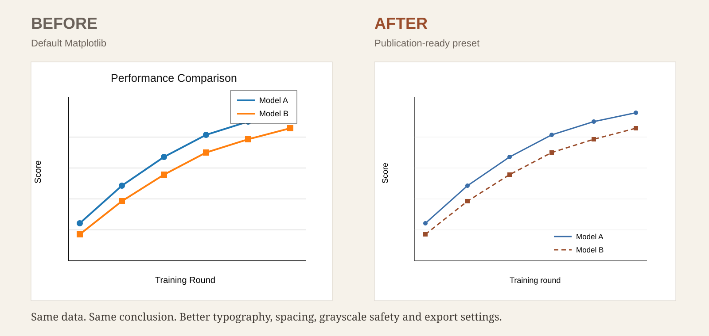

# Publication Figure Skill

Turn Matplotlib figures into clean, publication-ready academic graphics.

This is a deliberately small research-graphics skill. It does one thing: take an existing Matplotlib figure or plotting script and improve it for journal or conference use without changing the underlying data or statistical meaning.

## Before / after

Same data and same conclusion. The right-hand version changes only presentation: final-column sizing, typography, legend treatment, line/marker hierarchy, grayscale readability, and export settings.

## What it fixes

- inconsistent fonts and font sizes
- default Matplotlib styling
- crowded legends and axis labels
- clipped labels
- weak visual hierarchy
- inconsistent subplot spacing
- oversized titles
- poor export settings
- unreadable figures at journal column width
- low-resolution PNG-only output

## Core principle

Improve presentation, not results.

The skill should never alter values, reorder categories to imply a different result, hide uncertainty, remove inconvenient observations, or change statistical interpretation.

## Quick use

Give the skill your plotting code, target width, and optional target journal or conference.

Example prompt:

    Polish this Matplotlib figure for a two-column journal.
    Keep all data and labels unchanged.
    Export PDF, SVG and 600 dpi PNG.

## Presets

- single-column: 3.35 in wide
- double-column: 7.0 in wide
- two-panel: balanced horizontal pair
- four-panel: compact 2x2
- grayscale-safe: readable without color dependence

## Included files

- SKILL.md — reusable skill instructions
- presets.py — journal-size and typography presets
- examples/before_after.py — minimal before/after example
- examples/checklist.md — manual figure review checklist

## Author

Lujie Huang
https://lujiehuang.github.io/
